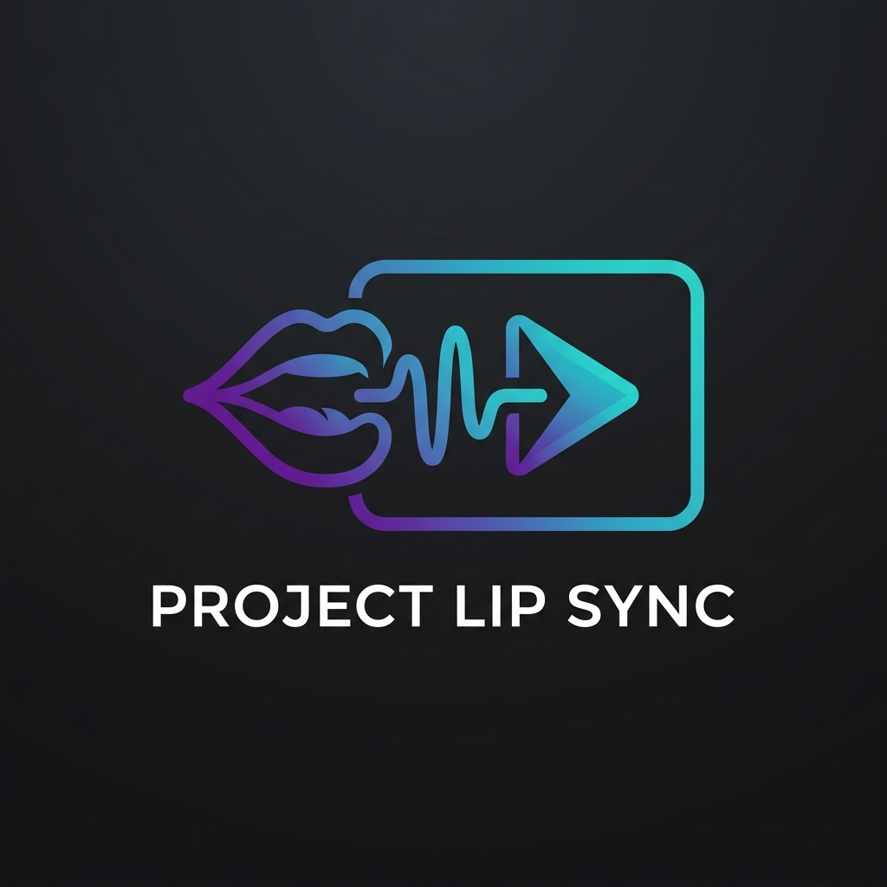

<p align="center">
  
</p>

# Project Lip Sync

Project Lip Sync is a web tool designed to translate and dub English lectures into Bangla. 

It fetches the transcript of a YouTube video, translates the captions using the Claude API, generates spoken audio in Bangla, and merges the new audio back into the original video with correct timing.

## What it does

- **Caption Translation:** Retrieves English subtitles from a YouTube URL and translates them into Bangla using Anthropic's Claude models.
- **Bangla Dubbing:** Converts the translated text into spoken Bangla audio using Microsoft Edge TTS.
- **Audio Mixing & Video Muxing:** Stretches and aligns the generated audio segments to match the original video timing, downloading the video using `yt-dlp` and mixing it with the new audio track using `ffmpeg`.
- **Dual Playback Web Player:** Provides a web interface to play the YouTube video with real-time Bangla subtitles, toggle between original English audio and the Bangla dub, and download the finished dubbed video.
- **Human Evaluation & Feedback:** After a video is dubbed, the player exposes a feedback panel so human reviewers can rate overall quality, lip-sync accuracy, and audio clarity/speed; report audio-video sync issues; flag per-segment problems (wrong translation, bad lip sync, too fast/slow, audio glitch, caption issue); and leave free-text comments and improvement suggestions. Feedback is persisted to `feedback/evaluations.jsonl`.

## Prerequisites

To run this project, you need:
- **Python 3.10+**
- **FFmpeg** installed on your system and available in your command line path.
- **Anthropic API Key** (for translation).

## Setup & Installation

1. Clone the repository:
   ```bash
   git clone <your-repo-url>
   cd project-lip-sync
   ```

2. Create a virtual environment and activate it:
   ```bash
   python -m venv .venv
   source .venv/bin/activate  # On Windows: .venv\Scripts\activate
   ```

3. Install the dependencies:
   ```bash
   pip install -r requirements.txt
   ```

4. Create a `.env` file in the root directory (you can copy `.env.example` as a starting point) and add your keys:
   ```env
   ANTHROPIC_API_KEY=your_anthropic_api_key
   ANTHROPIC_MODEL=claude-haiku-4-5
   ```

## Running the App

1. Start the FastAPI server:
   ```bash
   uvicorn main:app --reload            # development, defaults to :8000
   ```

   For the long-running instance the watcher and the plaza expect, use **:8050**
   and no `--reload` (the reloader restarts mid-dub and drops in-flight jobs):
   ```bash
   python -m uvicorn main:app --host 0.0.0.0 --port 8050
   ```
   or the startup wrapper, which pins the interpreter and tees to `logs/server.*`:
   ```bash
   run_server.cmd
   ```
   8050 is not cosmetic: `resume_30.py`, `batch_runner.py` and `monitor_resume30.py`
   all hard-code `http://127.0.0.1:8050`, so a server on 8000 leaves them talking
   to a closed port. Register `run_server.cmd` **at startup only** — it is resident,
   and a repeating trigger would stack a second uvicorn on a taken port.

2. Open your browser and navigate to:
   ```
   http://127.0.0.1:8050
   ```

3. Paste a YouTube URL with English subtitles and click **Translate** to start.

## Channel Watcher (automatic dubbing)

`watcher.py` polls the YouTube RSS feeds of **Yaqeen Institute** and **Yasir Qadhi**
and dubs qualifying new uploads on its own, publishing them straight to the plaza.

```bash
python watcher.py bootstrap        # run ONCE: marks the current feed as seen
python watcher.py check            # one poll + reconcile + launch cycle
python watcher.py check --dry-run  # decide, but launch nothing
python watcher.py status           # what is queued / running / done / skipped
python watcher.py enqueue <ID|URL> # hand-add a video, bypassing the feed filters
```

The Windows scheduled task **LipSync Channel Watcher** runs `run_watcher.cmd`
(i.e. `watcher.py check`) every 30 minutes and at startup, so nothing needs to
stay resident. Each tick is a short reconcile pass over `watcher_state.json`;
the dub itself is detached through `launch_pipeline.py` and outlives it.

Bootstrap is not optional. Without it the first tick finds ~30 videos sitting in
the two feeds and tries to dub every one of them. `bootstrap` marks the existing
backlog as seen (`--backfill N` deliberately keeps the N newest as work), so from
then on only genuinely new uploads are picked up.

### What gets skipped

Filters live in `watcher_config.json`, calibrated against the last 15 uploads of
both channels:

| Setting | Default | Why |
| --- | --- | --- |
| `min_duration_seconds` | 180 | Drops Shorts — 8 of Yaqeen's last 15 uploads were under 3 minutes |
| `max_duration_seconds` | 5400 | Keeps Yasir Qadhi's longest lectures (77 min observed) but caps runaway podcasts |
| `require_english_captions` | true | No English captions means the Whisper fallback, which is far slower and rougher |
| `skip_live` | true | Live and upcoming streams have no stable transcript |
| `max_concurrent` | 1 | Parallel dubs deepen the Edge-TTS throttling that kills runs |
| `max_launches_per_day` | 4 | Spend ceiling: each dub is a real Claude translation bill |
| `auto_process` | true | Set false to keep watching and queueing but stop launching |

Skipped videos are recorded with a reason, so `watcher.py status` shows what was
passed over and `watcher.py enqueue` can override any of it.

### Reaching the plaza

`/api/plaza` scans `output/*/manifest.json`, so a finished run is listed the
moment it completes — there is no separate publish step. What the watcher adds is
the metadata the pipeline never sees: it patches the real `title`, `channel`,
`published_at` and `source_url` into the manifest, which is what turns a plaza
card from a bare 11-character video ID into a named lecture.

A run only counts as done when `phase == "done"` **and** the manifest reports
`coverage >= 0.5`. A run that dies silently is retried once (`max_attempts`),
detected by `.work/progress.json` going quiet for `stall_minutes`.

## Human Evaluation

Once dubbing finishes, the player page shows a **Human Evaluation** panel below the video.

### Giving feedback

1. Rate the three dimensions using the star rows:
   - Overall quality (1–5)
   - Lip-sync accuracy (1–5)
   - Audio clarity / speed (1–5)
2. Select whether the video has **None**, **Minor**, or **Major** audio-video sync issues.
3. (Optional) Add a general comment and one free-text improvement suggestion.
4. Use the **Per-segment problems** list to report specific issues:
   - **Current segment** — report a problem for the segment being spoken right now.
   - **Individual segments** — each segment has its own category dropdown and note field.
   - Categories: `wrong_translation`, `bad_lip_sync`, `too_fast`, `too_slow`, `audio_glitch`, `caption_issue`, `other`.
5. Click **Submit feedback**. The UI will confirm once the record is saved.

### Storage

Feedback is saved to:

```
feedback/evaluations.jsonl
```

Each line is a JSON object keyed by `video_id`, with `segment_index` and `segment_start` for any per-segment issues, plus `submitted_at`.

### Viewing the report

Run the summary script from the project root:

```bash
python feedback_report.py
```

For JSON output or a single video:

```bash
python feedback_report.py --format json
python feedback_report.py --video VIDEO_ID
```

The report prints per-video and overall rating averages, sync-issue counts, segment-issue categories, the most-reported segments, comments/suggestions, and a prioritized revisit list.
